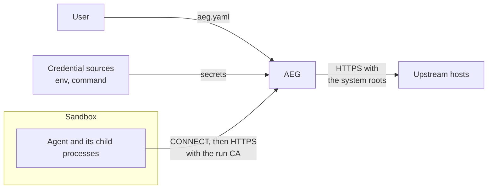

# Threat model

AEG keeps the real credentials out of the agent, and sends each credential only to the hosts and routes in `aeg.yaml`.
It assumes that the agent is hostile, for example after a prompt injection.
It does not stop the agent from misuse of a credential on a route that the configuration allows.

AEG is not a sandbox.
Each guarantee in this document is true only when a sandbox makes all the traffic of the agent go through AEG.

## System

1. AEG reads `aeg.yaml` and reads each secret from an environment variable or from a command.
2. AEG makes a certificate authority (CA) for the run, and starts the agent with the proxy variables and the CA bundle.
3. The agent sends `CONNECT host:port` to AEG. AEG ends TLS with a certificate for this host.
4. AEG checks each request in the tunnel, adds the credentials of the destination, and sends the request to `host:port`.

## Trust

| Party | Trust | Why |
|---|---|---|
| The user | Trusted | The user writes the configuration and owns the credentials. |
| `aeg.yaml` | Trusted | A `command` source runs with `sh -c`. A hostile configuration controls AEG. |
| Credential sources | Trusted | AEG uses the value that the source gives. |
| The operating system and the sandbox | Trusted | AEG cannot protect its memory or its port from the kernel or from the user account. |
| Public CAs and DNS | Trusted | AEG verifies the upstream certificate with the system roots. |
| Upstream hosts that get a credential | Partially trusted | AEG gives them the secret. It does not read what they send back. |
| The agent and its child processes | Not trusted | The agent controls each byte of each request. |
| Upstream hosts that get no credential | Not trusted | They can send any content to the agent. |

## Assets

1. **The credential values.** This is the main asset. A leak gives the attacker the identity of the user, outside of AEG and after the run.
2. **The policy.** The destinations and routes limit what the agent can do with a credential.
3. **The CA private key.** With this key, an attacker can impersonate any host to the clients that trust the run CA.

The placeholders are not secrets.
The agent holds them by design.

## Attacker

The attacker controls the agent.
The attacker can:

- send any CONNECT target, any TLS ClientHello and any HTTP request to AEG;
- read each response that AEG sends back;
- run any program in the sandbox, as the user of the agent.

The attacker wants to read a credential value, or to use a credential on a host or route that the configuration does not allow.

## What AEG guarantees

| Threat | Control |
|---|---|
| The agent reads a secret from its environment. | AEG removes each variable that a credential reads with `from.env`. It sets a placeholder in its place, if the configuration has one. |
| The agent sends a credential to a host that is not in the configuration. | AEG injects only on an exact `host:port`. A wildcard destination cannot inject. |
| The agent uses a `Host` header, an absolute URL or SNI that names another host. | AEG sends the request to the CONNECT host. It denies a `Host` header or a URL host that is not the CONNECT host. The certificate names the CONNECT host, whatever the SNI. |
| The agent uses a path that AEG and the upstream read differently. | AEG matches the raw path. It denies `//`, `.` and `..` segments, `\`, `;`, and the escapes `%2F`, `%2E`, `%5C`, `%25` and `%00`. |
| The agent changes the method, host or path with a header. | AEG denies `X-HTTP-Method-Override`, `X-Forwarded-Host` and the other headers in [errors.md](errors.md#policy_denied). |
| The agent leaves the policy with a protocol change. | AEG denies plain HTTP, a CONNECT in a tunnel and each `Upgrade` request, which includes WebSocket. |
| An upstream redirects the agent to another host. | AEG does not follow redirects. The client sends a new request, and AEG checks it again. |
| The agent sets its own value for the injected header. | AEG replaces the value of the header. |
| An attacker on the network reads or changes the upstream traffic. | AEG uses TLS 1.2 or later, and verifies the upstream certificate. AEG ignores the proxy variables, so it connects to the upstream directly. |
| The agent reads the CA key. | The key exists only in the memory of AEG. AEG writes only the CA certificate to disk. |
| The agent sends the placeholder of a credential to a host that does not inject it. | AEG denies the request with `placeholder_misuse`. This is a sign of prompt injection, and not a protection of the secret. AEG looks at the request target and the headers, and not at the body. |
| A secret goes into the log. | AEG logs the method, the host, the path, the status and the credential names. It does not log header values. |
| Another machine uses the proxy. | AEG listens on `127.0.0.1` by default. It refuses `0.0.0.0` and `::`, and it gives a warning for an IP that is not a loopback IP. |

## What AEG does not protect against

These are accepted risks.
Each one has a mitigation that the user must apply.

1. **Traffic that does not go through AEG.**
   An agent can ignore the proxy variables and connect directly.
   Run the agent in a sandbox that allows only the AEG port.

2. **Access to the credential sources.**
   An agent outside of a sandbox can run `gh auth token` itself, or read the file that the source reads.
   The sandbox must block the files, the sockets and the commands that give the secrets.

3. **Access to the memory of AEG.**
   A process of the same user can read the memory of AEG on some systems, for example with `ptrace` on Linux.
   The sandbox must block it.

4. **A hostile configuration.**
   An agent that can write `aeg.yaml` controls the next run.
   Keep the configuration in a directory that the agent cannot write.

5. **Misuse of a credential on an allowed route.**
   AEG does not know what a request means.
   On `POST /repos/acme/**`, the agent can do each action that the token permits on these paths.
   This includes data exfiltration to an allowed host.
   Give each credential the smallest permissions, and allow the smallest set of routes.

6. **An upstream that sends the credential back.**
   AEG does not read the responses.
   A host that echoes request headers, or an error page that shows them, gives the secret to the agent.
   Inject a credential only on the API that it is for.

7. **Other local processes.**
   The proxy has no authentication.
   Each process that can connect to the AEG port, of any user on the machine, can send requests with the credentials.
   Do not run AEG on a shared machine.

8. **Content from an upstream.**
   AEG does not filter responses.
   An allowed host can send a prompt injection to the agent.

9. **Denial of service.**
   The agent can overload AEG.
   This affects only the run of the agent.

10. **Expired or revoked secrets.**
    AEG reads each secret one time, when it starts.
    A secret that the source rotates after this time is not available until AEG restarts.
